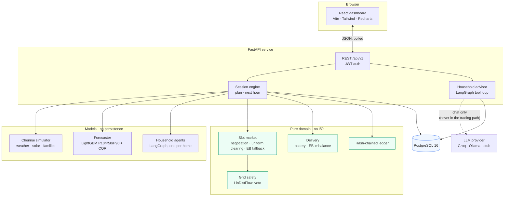
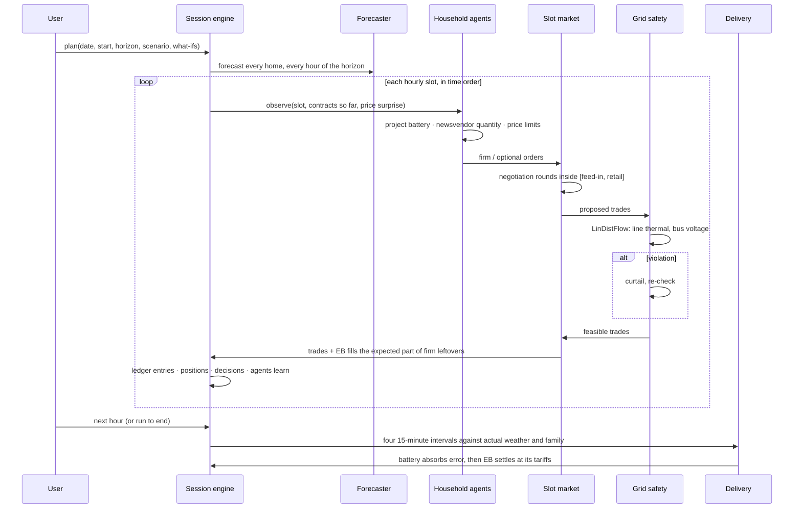

# Architecture

## System overview



The green layer is pure: deterministic functions with no database, network or clock access
([ADR-0006](adr/0006-pure-domain-layer.md)). The dotted LLM edge is the only one that may fail without
consequence for trading. The advisor answers questions beside the market and never decides a trade
([ADR-0005](adr/0005-llm-beside-the-critical-path.md), [ADR-0011](adr/0011-groq-advisor-as-a-tool-loop.md)).

Nothing runs on its own. A session moves forward only when a user plans it or asks for the next hour
([ADR-0008](adr/0008-planning-sessions-with-the-eb-as-provider.md)). The browser polls every 5 seconds to
pick up changes made from another tab.

---

## A planning session

The unit of work is the session: a date, a start hour, a horizon of 4, 8, 12 or 24 hours, a weather
scenario, and optional what-ifs. A session is **planned** once, then **delivered** hour by hour.



### Step detail

**1 · Forecast.** Each home's load and solar for every hour ahead, as P10, P50 and P90, from LightGBM
quantile models with conformal calibration ([ADR-0010](adr/0010-hourly-forecasts-with-conformal-calibration.md)).
What-ifs (guests, family away, work from home, panel derate) are model inputs, so the forecast reacts to
them.

**2 · Decide.** Each agent walks its battery through the rest of the session, then sizes its commitment
as a newsvendor, inside the forecast's calibrated band
([ADR-0009](adr/0009-newsvendor-agents-in-the-calibrated-band.md)). A real surplus or shortfall becomes a
**firm** order. Spare stored charge, or cheap energy bought to store, becomes an **optional** one.

**3 · Clear.** Households negotiate over a few rounds, each conceding toward its own limit. Every round
clears as a uniform-price double auction. A seller's limit is never below the feed-in tariff, and a
buyer's never above retail, so every trade is priced inside the band. This makes objective **O6**
structurally true **per trade**. Per session it is an empirical result: a hedge that isn't needed or a
forecast miss can still cost a household money.

**4 · Grid safety.** A linearised DistFlow solve over the feeder checks line thermal limits and bus
voltages. Violations curtail trades and re-check, thermal first. This layer has **veto power**.

**5 · The EB.** Whatever is left of a firm order's *expected* quantity, the EB takes: it sells at retail
and buys at feed-in. Optional orders and hedges never fall back to the EB. During a power cut there is no
fallback, so unmatched need is unserved.

**6 · Record.** Each trade is appended to a ledger in which every entry carries the hash of the one before.
Tampering with any trade breaks every hash after it. Offers, positions, curtailments and every agent
decision, with its message and reasons, are stored in the same transaction as the plan.

**7 · Deliver.** "Next hour" plays the slot out in 15-minute intervals against what the simulated weather
and family actually do. Neighbour contracts are honoured. The battery absorbs the difference first, and
the EB settles the rest at its tariffs. During a power cut, what the battery can't cover is unserved and
surplus it can't store is curtailed.

---

## Layering

Dependencies point inward only. Nothing in `domain/` imports from any layer above it.

```
api/                     ← HTTP, auth, request/response mapping
      ↓
engine/                  ← sessions: orchestration, persistence, transactions
      ↓
agents/ · forecasting/ · simulator/
      ↓
domain/                  ← pure: market, grid, battery, settlement, ledger
```

| Package | Responsibility | May do I/O |
|---|---|---|
| `app/api/` | Routes, auth, request/response mapping | yes |
| `app/engine/` | Plans and delivers sessions, builds statements, owns transactions | yes |
| `app/agents/` | Agent decision graph, memory and learning, speech, the advisor and its LLM providers | yes (advisor and memory persistence) |
| `app/forecasting/` | Features, dataset, training, calibrated inference | reads model files |
| `app/simulator/` | Synthetic weather, solar and families; the cross-check suite ([ADR-0007](adr/0007-calibrated-synthetic-chennai-data.md)) | no |
| `app/models/`, `app/schemas/` | ORM tables and API contracts | — |
| **`app/domain/`** | Slot market, negotiation, auction, grid safety, battery, delivery, ledger | **no** |

---

## Data model

| Table | Holds |
|---|---|
| `users`, `households` | Accounts, and each home's family size, panel size, battery, reserve and charge |
| `simulation_state` | The one session: date, start hour, horizon, scenario, what-ifs, status, clock |
| `session_households` | Each home's what-ifs and starting charge for this session |
| `session_forecasts` | P10/P50/P90 load and solar per home per hour |
| `agent_decisions` | Every agent decision: strategy, quantity, limits, risk quantile, expected price, message, reasons, outcome (**O7**) |
| `agent_memory` | Each agent's learned margins and hour-of-day prices, kept across sessions |
| `negotiation_offers` | Every offer in every negotiation round |
| `trades` | Matched neighbour trades; immutable |
| `ledger_entries` | Append-only, hash-chained record of every trade |
| `curtailments` | Trades the grid safety layer cut, and why |
| `session_positions` | Per home per hour: bought and sold with neighbours and with the EB, unserved |
| `meter_readings` | Delivered 15-minute intervals: load, solar, battery, EB flow, unserved, curtailed |

PostgreSQL runs from the TimescaleDB image ([ADR-0002](adr/0002-single-postgres-with-timescaledb.md)), but
at 10 homes × 24 hours the tables are plain and indexed. Hypertables are not used.

---

## Failure behaviour

| Failure | Consequence |
|---|---|
| LLM unavailable or rate-limited | The advisor answers from the same tools through the stub provider. **Trading unaffected.** |
| Forecast model files missing | Forecasts fall back to seasonal-naive (the same hour yesterday), and the session reports which model it used. |
| Postgres unavailable | Requests fail and readiness returns 503. A plan and each delivered hour are each one transaction, so nothing partially settles. |
| Grid check infeasible | Trades are curtailed until feasible, and the EB covers the expected part of firm orders. In the worst case a slot clears empty and every home deals with the EB. Never an unsafe allocation. |
| EB power cut (a what-if) | No fallback during the cut. Agents charge up beforehand; unmet need is recorded as unserved, not hidden. |
| Plan or next hour in the wrong state | 422 for an invalid plan, 409 for delivering a session that isn't planned. |

## Measuring it

`python -m app.evaluation` (`app/evaluation/`, [ADR-0012](adr/0012-measuring-the-objectives.md)) runs
a fixed suite of seeded sessions in memory with the same `SessionMarket`, agents, forecaster and delivery
code the app runs, and writes [evaluation.md](evaluation.md): the O1–O7 table against the targets in
[objectives](objectives.md). Beside it:

- a hindsight-optimal linear program for O2 (`optimum.py`);
- a full AC power flow in pandapower for O4 (`ac_check.py`);
- the PyTorch LSTM forecasting benchmark for O1 (`lstm.py`), in its own image:
  `docker compose --profile bench run --rm bench`.

## Not built

- WebSocket streaming. The browser polls, and Redis runs in Compose but nothing uses it.

## Further reading

- [Objectives](objectives.md): how O1–O7 are measured
- [Evaluation](evaluation.md): the measured results
- [Runbook](runbook.md): operating and troubleshooting
- [ADRs](adr/): why the system looks the way it does
